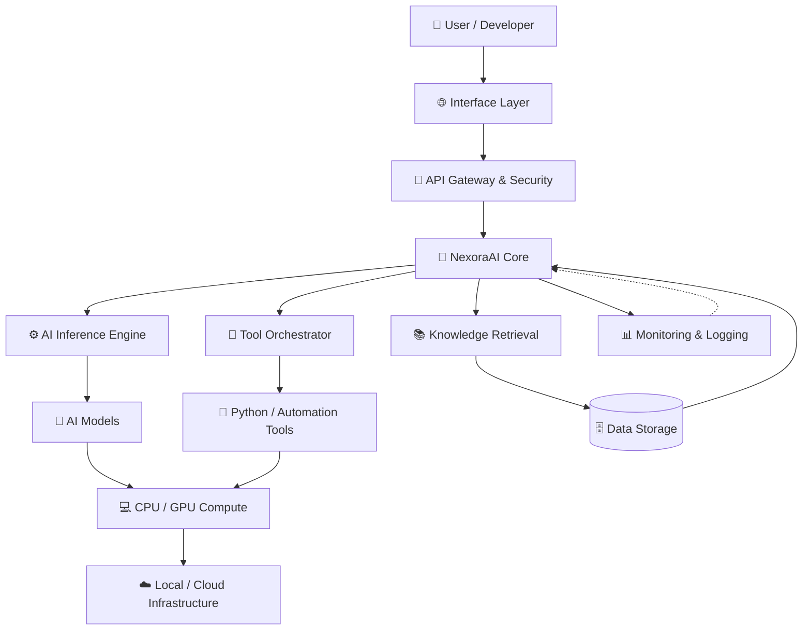

# Artificial Intelligence Development — Engineering Intelligent Systems for the Next Digital Frontier
# winter-Alanalys -Comunication 
## 🏗️ System Architecture

NexoraAI is designed as a modular AI architecture that integrates user interfaces, request orchestration, AI inference, external tools, and computational infrastructure.

### Architecture Components

| Component | Responsibility |
|---|---|
| Interface Layer | Provides access through a web interface, CLI, or API client. |
| API Gateway & Security | Handles request validation, authentication, and access control. |
| NexoraAI Core | Coordinates application logic and AI processing workflows. |
| AI Inference Engine | Executes inference using supported AI models. |
| Tool Orchestrator | Coordinates approved Python tools and automation tasks. |
| Knowledge Retrieval | Retrieves relevant information from configured data sources. |
| Data Storage | Stores application data and other supported information. |
| Monitoring & Logging | Records application events, errors, and performance metrics. |
| Compute Infrastructure | Provides CPU, GPU, and local or cloud execution resources. |

### Request Processing Flow

1. A user submits a request through a supported interface.
2. The API layer validates the request and enforces access controls.
3. NexoraAI Core determines the appropriate processing workflow.
4. The inference engine and supporting tools process the request.
5. Relevant information is retrieved when required.
6. The application returns the generated result to the user.
7. Monitoring components record relevant events and operational metrics.

> **Note:** This diagram represents a proposed architecture. Actual components and capabilities depend on the implementation, configuration, and infrastructure deployed.
## Abstract

This project explores the engineering, integration, and continuous refinement of Artificial Intelligence (AI) systems designed to expand computational capabilities, streamline complex workflows, and facilitate more sophisticated human–machine interaction.

At its core, the initiative is driven by the premise that artificial intelligence should transcend conventional automation. Rather than merely executing predefined instructions, intelligently orchestrated systems can assist with contextual interpretation, information synthesis, computational reasoning, and adaptive problem-solving, depending on the underlying models and implementation.

The project serves as a foundation for experimentation with contemporary AI architectures, computational methodologies, software engineering practices, and scalable infrastructure. Its broader objective is to transform emerging AI capabilities into practical, extensible, and operationally meaningful applications.

## Vision: Engineering Beyond Conventional Computation

The evolution of artificial intelligence represents a paradigm shift in how computational systems interpret information, generate outputs, and support human decision-making.

Traditional software generally operates through explicitly defined rules and deterministic procedures. AI-enabled applications introduce additional capabilities through learned representations, probabilistic inference, contextual processing, and model-driven generation.

This project investigates how these capabilities can be integrated into a coherent software ecosystem that prioritizes utility, extensibility, computational efficiency, and responsible deployment.

The vision is not simply to construct another AI-powered application, but to cultivate an engineering framework in which intelligent technologies can be explored, evaluated, and adapted to evolving computational demands.

## Core Objectives

The development process is guided by several interconnected objectives:

- **Intelligence Augmentation:** Enhance human capabilities through computational assistance, information synthesis, and model-assisted problem-solving.
- **Algorithmic Efficiency:** Reduce unnecessary computational overhead through optimized execution paths, resource-aware processing, and appropriate model selection.
- **Workflow Orchestration:** Connect individual operations into coherent workflows that minimize repetitive intervention and improve operational consistency.
- **Architectural Extensibility:** Establish a modular foundation that can accommodate additional models, services, interfaces, and computational components.
- **Experimental Innovation:** Encourage systematic exploration of emerging AI techniques, software methodologies, and infrastructure configurations.
- **Responsible Engineering:** Incorporate considerations of security, transparency, reliability, and human oversight throughout the development lifecycle.

## The Computational Foundations of AI

Artificial intelligence is an interdisciplinary field encompassing machine learning, deep neural networks, natural language processing, computer vision, probabilistic modeling, and generative computation.

Each discipline contributes distinct capabilities to the development of intelligent applications.

Machine learning enables computational models to identify statistical regularities within data. Deep learning extends this approach through multilayer neural architectures capable of representing complex relationships. Natural language processing facilitates computational interaction with human language, while generative models enable the synthesis of new content based on learned patterns and contextual inputs.

The practical value of these technologies depends on the relationship between model capabilities, data quality, inference architecture, system constraints, and the application domain.

Consequently, this project treats AI development as an iterative engineering discipline rather than a purely theoretical exercise.

## Intelligent Workflow Orchestration

One of the principal opportunities presented by AI is the orchestration of heterogeneous computational processes.

A well-designed application can coordinate user input, information retrieval, model inference, data transformation, and output generation through a unified execution pipeline.

Depending on its implemented capabilities, such an architecture may support:

- Context-aware information processing.
- Automated execution of repetitive computational tasks.
- AI-assisted content synthesis and transformation.
- Structured data interpretation and summarization.
- Integration with external services through application programming interfaces.
- Model-assisted development, experimentation, and technical analysis.

The objective is to minimize unnecessary friction between individual operations while preserving observability, predictable execution, and appropriate control over consequential actions.

## Computational Performance and Resource Optimization

Modern AI workloads can impose substantial demands on processing power, memory bandwidth, storage, and network infrastructure.

Performance optimization therefore constitutes an important dimension of intelligent system engineering.

Potential optimization strategies include efficient batching, caching, asynchronous execution, memory management, model quantization, and workload-specific hardware acceleration.

For compatible workloads, graphical processing units (GPUs) can substantially accelerate parallel numerical computation. Cloud-based infrastructure may also provide access to specialized accelerators when local hardware is insufficient.

Nevertheless, computational scale alone does not guarantee superior results. Effective engineering requires balancing inference latency, throughput, model quality, resource utilization, operational expenditure, and reliability.

The guiding principle is to allocate computational resources according to measurable requirements rather than assuming that greater infrastructure complexity automatically produces better outcomes.

## Practical Value and Application Benefits

### 1. Productivity Augmentation

AI-assisted applications can reduce the time required to organize information, generate preliminary content, explore solutions, and perform repetitive operations.

By delegating suitable subtasks to computational systems, users can devote more attention to strategic thinking, creative exploration, and complex decision-making.

### 2. Knowledge Discovery

AI can facilitate the exploration of large information spaces by identifying relationships, organizing unstructured material, and producing contextual summaries.

These capabilities may support education, research, software development, and analytical workflows, provided that generated conclusions are appropriately verified.

### 3. Software Engineering Assistance

AI-enabled development environments can assist with code interpretation, documentation, debugging hypotheses, algorithm design, and implementation planning.

Such assistance can improve development workflows, although generated code must still undergo testing, security review, and human evaluation before production deployment.

### 4. Operational Automation

When integrated with suitable tools and permission boundaries, AI can help coordinate multi-stage processes and reduce repetitive manual intervention.

Reliable automation requires explicit execution constraints, error handling, monitoring, and human approval wherever actions carry significant consequences.

### 5. Creative and Technical Exploration

Generative AI expands the range of ideas that can be explored during prototyping, research, and product development.

Its value lies not only in producing outputs, but also in accelerating experimentation and enabling developers to compare alternative approaches.

## Architectural Philosophy

The long-term maintainability of an AI application depends on more than model selection. Its architecture must accommodate change without introducing unnecessary coupling or operational fragility.

This project embraces several engineering principles:

**Modularity:** Separate components according to their responsibilities, making individual subsystems easier to test, replace, and maintain.

**Interoperability:** Prefer well-defined interfaces that allow compatible models, libraries, and external services to communicate effectively.

**Observability:** Use meaningful logging, metrics, and error reporting to understand system behavior and diagnose failures.

**Reproducibility:** Document dependencies, configuration requirements, and evaluation procedures to make experiments easier to replicate.

**Security by Design:** Protect credentials, validate inputs, restrict permissions, and avoid exposing sensitive information through logs or application interfaces.

**Iterative Refinement:** Treat evaluation and feedback as integral parts of development rather than activities performed only after implementation.

These principles provide a practical foundation for evolving an experimental application into a more dependable software system.

## Ethical Considerations and Reliability

AI systems can produce inaccurate, incomplete, biased, or misleading outputs. Their behavior may also vary according to model versions, input characteristics, and inference settings.

Responsible development therefore requires appropriate validation, transparent communication of limitations, and human oversight for consequential decisions.

Data minimization, secure credential management, controlled access, and careful handling of sensitive information should be considered throughout the development process.

The objective is not to present AI as infallible, but to engineer systems whose capabilities and limitations can be understood, evaluated, and managed.

## Future Research and Development

Potential future directions include:

- Integration of additional AI models and inference backends.
- Exploration of retrieval-augmented generation and knowledge-grounded responses.
- Improved inference efficiency and hardware utilization.
- Modular tool integration and controlled workflow automation.
- Expanded evaluation procedures and automated regression testing.
- More comprehensive monitoring and diagnostic capabilities.
- Improved deployment portability across compatible environments.
- Stronger privacy controls and security-oriented design.
- Community-driven experimentation and collaborative development.

These directions represent prospective opportunities rather than assertions that every capability is already implemented.

## Open Development and Collaboration

This repository is intended to support experimentation, technical learning, and continued refinement of AI-enabled software.

Developers, researchers, students, and technology enthusiasts can contribute by examining the implementation, identifying defects, proposing improvements, strengthening documentation, and evaluating alternative approaches.

Constructive collaboration can help expose architectural weaknesses, improve reproducibility, and expand the range of use cases explored by the project.

Contributions should prioritize technical clarity, maintainability, reproducible behavior, and measurable improvements over unnecessary complexity.

## Closing Perspective

Artificial intelligence is most valuable when sophisticated computational capabilities are translated into systems that solve meaningful problems.

The development of intelligent applications requires a combination of algorithmic understanding, software engineering discipline, empirical evaluation, and responsible technological judgment.

This project represents an ongoing exploration of that intersection: transforming computational intelligence into practical functionality while preserving an emphasis on efficiency, extensibility, reliability, and continued learning.

The ultimate ambition is to contribute to an ecosystem in which AI technologies become not merely more powerful, but also more useful, accessible, understandable, and responsibly engineered.

**Explore the possibilities. Engineer with precision. Build intelligence with purpose.**

---

*Project scope, implemented features, supported models, and performance characteristics depend on the actual source code and deployment environment. Contributions and technical feedback are welcome, subject to the repository's license and contribution guidelines.*
